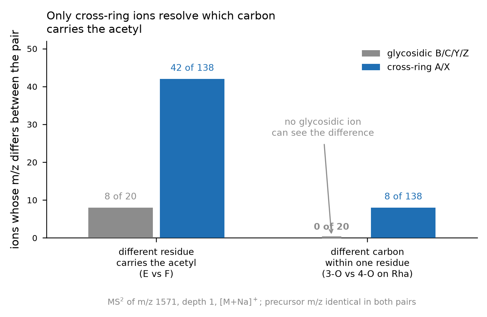

# rgi-msn-interpreter

MS<sup>n</sup> fragment interpreter for per-acylated, partially *O*-acetylated
rhamnogalacturonan-I (RG-I) oligomers.

Built for the derivatization strategy of Fernando, Yang, Archer-Hartmann, Shahin, Zhang,
Urbanowicz, Heiss & Azadi, *J. Am. Soc. Mass Spectrom.* **2026**, *37*, 1160-1172
([doi:10.1021/jasms.5c00440](https://doi.org/10.1021/jasms.5c00440)): native *O*-acetyl
groups are locked in place by per-trideuteroacetylation or per-propionylation of the free
hydroxyls, and the oligomer is sequenced by sodiated positive-mode CID (MS<sup>2</sup>)
followed by CID or HCD (MS<sup>3</sup>) on an Orbitrap.

The problem this addresses is not mass measurement but **assignment**: a single MS<sup>3</sup>
peak of a DP6 RG-I oligomer is compatible with many distinct cleavage paths, and most of
those are exactly isobaric. The interpreter is therefore built to return a *candidate set
with quantified ambiguity*, never a single best assignment.

## Method in one paragraph

Each candidate oligomer is built as an explicit **atom graph** - RG-I backbone,
&Delta;4,5-unsaturated GalA at the non-reducing end, every free OH blocked, native
*O*-acetyls in place, optional Gal side chain. Fragments are generated by cutting bonds on
that graph, so a cross-ring ion's mass follows from which carbons it keeps and what is
esterified on them, so no tables of per-residue cross-ring increments are maintained in this
implementation. Full conventions are in [docs/METHOD.md](docs/METHOD.md).

- glycosidic B/C/Y/Z and cross-ring A/X ions in Domon-Costello nomenclature
- MS<sup>n</sup> precursor selection to arbitrary depth
- positional-isomer enumeration and scoring against an observed peak list
- reads Thermo FreeStyle CSV exports directly - parses the scan filter for the
  MS<sup>n</sup> path and polarity, centroids profile data, removes <sup>13</sup>C
  isotopologues and corrects a measured calibration offset (`rgi_io.py`)
- mixture deconvolution - the smallest set of isomers explaining the observed intensity,
  which is the normal situation for an RG-I digest
- every competing assignment for a peak, not one best guess



**Figure 1.** What the atom-level representation is for. Two kinds of positional isomer are
not equally hard. When a *different residue* carries the native acetyl (isomers E and F),
8 of the 20 glycosidic ions already differ, so residue-level bookkeeping suffices. When a
*different carbon of the same residue* carries it (3-*O*- vs 4-*O*-acetyl rhamnose), the
precursor and **all 20 glycosidic ions are identical**, and only cross-ring ions differ -
8 of 138 at MS<sup>2</sup>, and 267 of 1,824 at MS<sup>3</sup> of Y<sub>4</sub>. Which
cross-ring ions differ is decided by which carbons the fragment retains. This is a property
of the chemistry, not of any particular software - see "Relationship to existing fragment
calculators".


**Figure 2.** (a) Observed MS<sup>2</sup> of *m/z* 1571.61 ([M+Na]<sup>+</sup>, CID 30,
deuteroacetylated DP6), centroided from the raw profile export and calibration-corrected.
Eight of the 20 predicted glycosidic ions - B<sub>4</sub>, B<sub>5</sub>, C<sub>4</sub>,
C<sub>5</sub>, Y<sub>1</sub>, Y<sub>2</sub>, Z<sub>1</sub>, Z<sub>2</sub> - carry the 3-Da
separation between isomer E (3-*O*-Ac on the reducing-end Rha) and isomer F (3-*O*-Ac on the
inner Rha). Three of those pairs have both members above the noise floor in this spectrum and
are annotated (E value / F value). (b) Mean number of candidate
assignments per assignable MS<sup>3</sup> peak against mass tolerance, for the MS<sup>3</sup>
of *m/z* 1087.42 (Y<sub>4</sub>) at `depth=2`, n = 20 assignable peaks. The shaded band is
the measured peak-to-peak mass scatter of these Orbitrap spectra after removal of a
per-spectrum calibration offset (0.68 mmu at MS<sup>2</sup>, 0.84 mmu at MS<sup>3</sup>).
At 5 mmu every assignable peak receives exactly one candidate; loosening to the window
customary for ion-trap MS<sup>n</sup> adds 55 % more candidates and no additional assigned
peaks.

## Relationship to existing fragment calculators

**This section previously claimed that the atom-level representation was needed to place an
acyl group on the right carbon, and that residue-and-substituent tools could not do it. That
claim was wrong and has been withdrawn.** It was checked against the GlycanBuilder source
(the fragmentation engine behind GlycoWorkbench; the Google Code project is mirrored at
[github.com/sivarajankumar/glycanbuilder](https://github.com/sivarajankumar/glycanbuilder))
and does not survive:

- Cross-ring fragment types are tabulated in `src/conf/cross_ring_fragment_types` - 354 rows
  keyed by residue class, anomeric carbon, ring size, A/X and the two cleavage positions,
  each carrying a composition, methyl/acetyl counts and a `LinkPos` list of the linkage
  positions the fragment retains.
- That coverage includes everything an RG-I backbone needs: `HexA,ManA,GalA,GlcA,IdoA`,
  the Delta-4,5-unsaturated series `4uHexA,4uManA,4uGalA,4uGlcA,4uIdoA`, and Rha via
  `dHex,Fuc,Rha,dTal`.
- Substituents attached as child residues *are* apportioned across a cross-ring cut by
  position: `Fragmenter.getXFragment` and `getAFragment` loop over the children and keep
  only those whose linkage position satisfies `ResidueType.areValidPositions` against that
  table row (`Fragmenter.java` lines 911-916 and 815-820; `ResidueType.java` line 702).
- Internal fragments are enabled by default (`internal_fragments = true`), with
  `max_no_cleavages = 2` and `max_no_crossrings = 1` as adjustable defaults.

So a 3-*O*- versus 4-*O*-acetyl rhamnose is representable and distinguishable in that
framework, provided the acetyl is modelled as a position-attached child residue rather than
through the global per-derivatization count. No architectural novelty is claimed here over
it.

What remains genuinely different is narrower, and is about bookkeeping and output rather
than chemistry:

- **Mixed isotopologue labelling.** The derivatization model there is a global count
  (`nmethyls` / `nacetyls` per residue type) over one global acetyl species
  (`MassUtils.acetyl` = C2H3O, `dacetyl` = C2D3O). This workflow needs one native acetyl and
  twelve d<sub>3</sub>-acetyls on the same molecule, each at a known position. Whether that
  composes correctly by mixing a global d<sub>3</sub>-acetyl derivatization with an explicit
  native-acetyl child residue has **not been tested**, and is the one comparison worth
  actually running.
- **Output semantics.** Fragments here are keyed by their atom set, so isobaric cleavage
  paths stay distinct and the degeneracy of a peak is countable (1,855 partitions to 1,855
  labels over 541 distinct *m/z* for the MS<sup>3</sup> of Y<sub>4</sub> at depth 2); an
  MS<sup>n</sup> precursor path excludes candidates that cannot produce it, with the reason
  recorded; and the reported unit is a candidate set, or for digests a minimal set of
  co-eluting isomers, rather than a ranked annotation.
- **Instrument-file handling.** Reading Thermo FreeStyle profile exports, centroiding,
  deisotoping and per-spectrum calibration correction are in scope here.

What this tool does *worse*: it covers only RG-I backbones with an optional Gal branch and a
fixed set of acyl donors, against arbitrary topologies, 20 residue classes of tabulated
cross-ring fragments and a far wider range of derivatizations.

### Prior art

Combinatorial bond breaking on an explicit molecular graph is **not** a new idea, and no
claim of algorithmic novelty is made for it. MetFrag introduced systematic bond
disconnection of a candidate structure for metabolite spectra at a single MS level
(Wolf, Schmidt, Mueller-Hannemann & Neumann, *BMC Bioinformatics* **2010**, 11, 148,
[doi:10.1186/1471-2105-11-148](https://doi.org/10.1186/1471-2105-11-148)), and MAGMa
extended exactly this to multistage data, generating a hierarchical tree of substructures
down an MS<sup>n</sup> spectral tree (Ridder, van der Hooft, Verhoeven, de Vos, van Schaik &
Vervoort, *Rapid Commun. Mass Spectrom.* **2012**, 26, 2461,
[doi:10.1002/rcm.6364](https://doi.org/10.1002/rcm.6364); applied in *Anal. Chem.* **2013**,
85, 6033, [doi:10.1021/ac400861a](https://doi.org/10.1021/ac400861a)). The fragment
generator here is architecturally in that family: sequential partitioning of a parent
substructure, one partition per MS level.

The established glycan tools return Domon-Costello ions from residue-and-topology
representations - GlycoWorkbench (Ceroni, Maass, Geyer, Geyer, Dell & Haslam,
*J. Proteome Res.* **2008**, 7, 1650,
[doi:10.1021/pr7008252](https://doi.org/10.1021/pr7008252)), Glyco-Peakfinder (Maass et al.,
*Proteomics* **2007**, 7, 4435,
[doi:10.1002/pmic.200700253](https://doi.org/10.1002/pmic.200700253)), GlycoDeNovo
(Hong et al., *J. Am. Soc. Mass Spectrom.* **2017**, 28, 2288,
[doi:10.1007/s13361-017-1760-6](https://doi.org/10.1007/s13361-017-1760-6); GlycoDeNovo2,
Chen et al., **2022**, 33, 436,
[doi:10.1021/jasms.1c00288](https://doi.org/10.1021/jasms.1c00288)), and more recently
learned approaches (Urban et al., *Nat. Methods* **2024**, 21, 1206,
[doi:10.1038/s41592-024-02314-6](https://doi.org/10.1038/s41592-024-02314-6); Bligh et al.,
*J. Am. Soc. Mass Spectrom.* **2025**, 36, 1686,
[doi:10.1021/jasms.5c00093](https://doi.org/10.1021/jasms.5c00093)).

The literature search behind this section was bounded, not exhaustive.

## Mass tolerance does not need to be loosened at deeper MS<sup>n</sup>

The practice of widening the mass window as MS<sup>n</sup> depth increases comes from
ion-trap instruments, where the MS<sup>3</sup> product scan is mass-measured in the trap and
accuracy degrades with each isolation step. It does not transfer to these data. All
MS<sup>n</sup> stages here are mass-analysed in the Orbitrap, and the measured accuracy is
constant across levels:

| spectrum | level | activation | ions matched | calibration offset | residual after offset (median) | worst residual |
|---|---|---|---|---|---|---|
| *m/z* 1571.61 | MS<sup>2</sup> | CID 30 | 20 | +3.48 mmu | **0.68 mmu** (0.68 ppm) | 2.22 mmu |
| 1571.61 &rarr; 1087.42 | MS<sup>3</sup> | CID 30 &rarr; HCD 30 | 24 | &minus;1.67 mmu | **0.84 mmu** (1.69 ppm) | 4.33 mmu |
| 1571.61 &rarr; 1087.42 | MS<sup>3</sup> | CID 30 &rarr; CID 30 | 7 | &minus;1.82 mmu | **0.28 mmu** (0.54 ppm) | 3.79 mmu |

Per-ion residuals: [data/rgi_mass_accuracy.csv](data/rgi_mass_accuracy.csv).

What differs between spectra is a **systematic offset of a few mmu**, comparable in size at
MS<sup>2</sup> and MS<sup>3</sup> and of either sign - a calibration property of the
acquisition, not a loss of resolving power. The correct response is therefore to measure
and subtract that offset (`rgi_io.estimate_offset`) and keep a tight window at every level,
not to widen the window. Because the competing assignments are isobaric rather than merely
close (see below), a wider window buys no additional peaks and only inflates the candidate
list.

**Recommended setting: `tol_mmu=5` at every MS<sup>n</sup> level after offset correction.**
Widen only for data from an instrument whose MS<sup>n</sup> product scan is not acquired at
high resolution.

## Validation

| check | result |
|---|---|
| published precursor and MS<sup>2</sup> *m/z* | [35 / 35](data/rgi_validation.csv) reproduced |
| published MS<sup>2</sup> ions recovered from the **raw profile export** | [9 / 9](data/rgi_realdata_validation.csv), all within &plusmn;1.4 mmu after offset correction |
| published MS<sup>3</sup> cross-ring masses (Table 2) | [15 / 16](data/rgi_ms3_table2_check.csv) to within 1 mmu |
| Domon-Costello labels | recovered independently, e.g. *m/z* 401.0961 = B<sub>5</sub> <sup>3,5</sup>X<sub>Rha</sub> Z<sub>3</sub> |
| mass accuracy, MS<sup>2</sup> vs MS<sup>3</sup> | [constant](data/rgi_mass_accuracy.csv), 0.3-0.8 mmu median residual |

The full record, including three discrepancies the model finds in the published tables and
what is *not* validated, is in [docs/VALIDATION.md](docs/VALIDATION.md).

## Install and run

No dependencies - `rgi_msn.py`, `rgi_io.py` and the Tkinter front end are pure standard
library.

**Windows, no Python needed** - download from the [latest release](https://github.com/Yungstedt/rgi-msn-interpreter/releases/latest):

| file | what it is | SHA-256 |
|---|---|---|
| [RGI-MSn-Interpreter.exe](https://github.com/Yungstedt/rgi-msn-interpreter/releases/download/v0.2.0/RGI-MSn-Interpreter.exe) | single file | `877e73ccf778e29d0c1b60a6188f4fab9990214e9d5308a907f6f9c41d7a390f` |
| [RGI-MSn-Interpreter-win64.zip](https://github.com/Yungstedt/rgi-msn-interpreter/releases/download/v0.2.0/RGI-MSn-Interpreter-win64.zip) | same app as a folder | `b1143965f6316cdfd4985735b463dd04aa0fed466d841a37ef2fb4ed6d4cae23` |

Both are unsigned, so SmartScreen warns about an unknown publisher. Prefer the zip on
machines with a redirected or locked-down temporary directory. If the application will not
start, run it with `--selftest report.txt` for a diagnostic.

**Any platform, from source:**

```bash
git clone https://github.com/Yungstedt/rgi-msn-interpreter
cd rgi-msn-interpreter
python rgi_gui.py          # desktop app
```

Python 3.9+ with Tkinter (bundled with the Windows and macOS installers; on Debian or
Ubuntu, `sudo apt install python3-tk`).

As a library:

```python
import rgi_msn as R, rgi_io

DP6 = ['dGalA','Rha','GalA','Rha','GalA','Rha']       # non-reducing end first
E = R.RGIStructure(DP6, acyl='dAc', oac={(5,3):'Ac'}, name='E')
R.precursor_mz(E)                                      # 1571.6225  [M+Na]+

mol, frags = R.fragments_for(E, precursor_path=[1087.43], depth=2)   # MS3 of Y4
R.match_peaks(peaks, frags, E, tol_mmu=5)

# straight from the instrument export
sp    = rgi_io.read_spectrum('MS2_1571.csv')           # centroids profile data
peaks = rgi_io.deisotope(sp.peaks)
peaks = rgi_io.apply_offset(peaks, rgi_io.estimate_offset(peaks, [1275.4847, 773.2771]))

cands = R.enumerate_isomers(DP6, n_oac=1, acyl='dAc')
R.minimal_mixture(peaks, cands, depth=1, tol_mmu=5,
                  losses=rgi_io.NEUTRAL_LOSSES, coverage=0.95)
```

[docs/QUICKSTART.md](docs/QUICKSTART.md) walks through the application field by field.
[docs/METHOD.md](docs/METHOD.md) documents the chemistry model, cleavage conventions and
known limits. [docs/VALIDATION.md](docs/VALIDATION.md) is the validation record.

## Known limits

- At `depth=3` a DP6 generates ~11,800 distinct fragment species, and competing assignments
  for one MS<sup>3</sup> peak are largely **isobaric** - narrowing the tolerance thins them
  but cannot resolve them. Use `assign_all` and report the full candidate list.
- MS<sup>2</sup> alone does not localise the second component of a mixture; see
  [docs/VALIDATION.md](docs/VALIDATION.md).
- Acyl migration is not modelled; the derivatization is what prevents it. A two-component
  tie may in principle be one compound plus its own rearrangement product, since migration
  is mass-invariant.
- No noise model: intensity-weighted scoring uses raw intensities, so a weak peak near the
  detection limit carries the same weight per count as one on a clean baseline.
- `dGalA + H`<sub>2</sub>`O = GalA` exactly, so some internal B/Y fragments are isobaric
  with C/Z fragments one residue over.

## Status and reproducibility

Version 0.2.0. The four CSV files under [`data/`](data) are the outputs of the validation
runs described in [docs/VALIDATION.md](docs/VALIDATION.md) and are regenerated by the
commands listed there. Raw instrument files are not redistributed here; they are available
from the corresponding author of the method paper.

## Citing

Please cite the method paper,
[doi:10.1021/jasms.5c00440](https://doi.org/10.1021/jasms.5c00440). A technical note
describing this implementation is in preparation; until it appears, cite this repository by
URL and commit.
