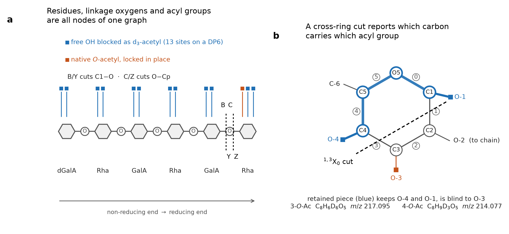

# Method - `rgi_msn.py`

MS<sup>n</sup> interpreter for per-acylated, partially *O*-acetylated RG-I oligomers.

Built for the derivatization scheme in Fernando, Yang, Archer-Hartmann, Shahin, Zhang,
Urbanowicz, Heiss & Azadi, *J. Am. Soc. Mass Spectrom.* **2026**, 37, 1160-1172
(doi:10.1021/jasms.5c00440): per-trideuteroacetylation or per-propionylation of a partially
*O*-acetylated RG-I oligomer, sodiated positive-mode CID (MS<sup>2</sup>) followed by CID or
HCD (MS<sup>3</sup>) on an Orbitrap.

## 1. Chemistry model

| feature | treatment |
|---|---|
| backbone | `[->2)-alpha-L-Rha-(1->4)-alpha-D-GalA-(1->]`, non-reducing end first |
| lyase product | &Delta;4,5-unsaturated GalA (`dGalA`) at the non-reducing end, Rha at the reducing end |
| blocking group | `dAc` +45.0294 &middot; `Prop` +56.0262 &middot; `Me` +14.0157 |
| native modification | `Ac` +42.0106, locked in place |
| branches | Gal on Rha O-4 (makes the Rha 2,4-linked) |
| acylatable sites | GalA O-2/O-3, Rha O-3/O-4, reducing-Rha anomeric O-1, Gal O-2/3/4/6 - **13 for a DP6 backbone** |

Fragment masses are computed atom-by-atom on an explicit molecular graph rather than from
residue increments, so a cross-ring ion's mass automatically reflects which acyl group sits
on which carbon. That is what distinguishes 3-*O*- from 2-*O*- or 4-*O*-acetylation.

## 2. Cleavage conventions



**Scheme 1.** Residues, linkage oxygens and acyl groups are all nodes of one graph (left).
At atom resolution (right) the six ring bonds are numbered as the code numbers them, and the
<sup>1,3</sup>X<sub>0</sub> cut keeps C1, O5, C5 and C4 - so it reports O-4 and O-1 and is
blind to O-3. The two positional isomers give this fragment the same 25 atoms in the same
connectivity but differ by 3.019 Da
(C<sub>8</sub>H<sub>6</sub>D<sub>6</sub>O<sub>5</sub>, *m/z* 217.095 for 3-*O*-Ac;
C<sub>8</sub>H<sub>9</sub>D<sub>3</sub>O<sub>5</sub>, *m/z* 214.077 for 4-*O*-Ac).


The glycosidic unit C1-O-Cp carries two cleavable bonds, giving B/Y (C1-O) and C/Z (O-Cp),
with the oxygen-retaining side gaining one hydrogen. Ring bonds are numbered 0: O5-C1,
1: C1-C2, 2: C2-C3, 3: C3-C4, 4: C4-C5, 5: C5-O5; a cross-ring cleavage cuts two of them,
the piece retaining C1 is the X fragment, and no hydrogen is transferred
(retro-Diels-Alder convention; &plusmn;H variants available at match time via
`h_transfer=True`).

Fragments are deduplicated by the frozen set of atoms they contain, so every species
returned carries a unique Domon-Costello label. `depth` is the number of successive
dissociation events modelled: `depth=1` is MS<sup>2</sup> of the intact precursor,
`depth=2` the MS<sup>3</sup> of a selected product, and so on. A DP6 at `depth=1-2` takes
under a second; `depth=3` generates about 11,800 species and takes roughly 20 s per
structure.

## 3. Usage

```python
import rgi_msn as R

DP6 = ['dGalA','Rha','GalA','Rha','GalA','Rha']       # non-reducing end first

# one named isomer: 3-O-acetyl on the reducing-end rhamnose
E = R.RGIStructure(DP6, acyl='dAc', oac={(5,3):'Ac'}, name='E')
R.precursor_mz(E)                                      # 1571.62  [M+Na]+

mol, frags = R.fragments_for(E, precursor_path=[1087.43], depth=2)   # MS3 of Y4
R.match_peaks(my_peaks, frags, E, tol_mmu=5)

# candidate enumeration + scoring against an observed peak list
cands = R.enumerate_isomers(DP6, n_oac=1, acyl='dAc')  # 12 positional isomers
res   = R.interpret(my_peaks, cands, depth=1, tol_mmu=5)
res.ranking

# mixtures (the normal case for RG-I digests)
R.minimal_mixture(my_peaks, cands, depth=1, tol_mmu=5, max_components=3)

# every competing assignment for one peak
R.assign_all(627.1921, frags, E, tol_mmu=5)

# which ions can actually tell two candidates apart
R.diagnostic_ions([iso_a, iso_b], depth=2, precursor=1087.43, tol_mmu=5)
```

Peak lists are plain `m/z` values or `(m/z, intensity)` pairs. Set `adduct='-H'` for
negative mode, `acyl='Prop'` for the propionyl derivative. Residue indices count from the
non-reducing end starting at 0; a Gal branch is given as the index of the Rha carrying it
and is always placed on O-4.

## 4. Reading real instrument data

`rgi_io.read_spectrum(path)` takes the Thermo FreeStyle **SPECTRUM - MS** CSV export
directly. That file is not a peak list: it carries a BOM, an eight-line metadata header
and, usually, *profile* data - tens of thousands of points spaced 0.0001-0.003 Da with over
half of them exactly zero. Handing that to a fragment matcher is meaningless, which is why
v0.1.0 struggled with it.

The reader:

- parses the scan filter, so the MS<sup>n</sup> precursor path, polarity and activation come
  from the file rather than from the operator -
  `FTMS + p ESI Full ms3 1571.6100@cid30.00 1087.4200@hcd30.00` becomes
  MS<sup>3</sup>, `+`, `[1571.61, 1087.42]`, `['cid','hcd']`;
- detects profile vs centroid data and **centroids** profile peaks by intensity-weighted
  apex fitting (84,889 points &rarr; 625 peaks on the MS<sup>2</sup> of *m/z* 1571);
- `deisotope()` removes <sup>13</sup>C isotopologues, which are about a third of the strong
  peaks and otherwise dilute intensity-weighted scoring;
- `estimate_offset()` / `apply_offset()` measure and remove a constant calibration bias
  against ions of known mass.

Two matching options matter on real data and are off by default in the library, on in the
application: `losses=rgi_io.NEUTRAL_LOSSES` (loss of d<sub>3</sub>-acetic acid, 63.040,
dominates these spectra, then acetic acid and water), and `coverage=` on `minimal_mixture`,
which asks for a fraction of the *explainable* intensity rather than demanding every peak be
explained - a real spectrum also contains the surviving precursor, noise and out-of-model
losses, so an all-or-nothing rule simply fails.

## 5. Mass accuracy and the choice of tolerance

**Mass tolerance does not have to be loosened at deeper MS<sup>n</sup> levels on these
data.** The convention of widening the window with MS<sup>n</sup> depth derives from
ion-trap instruments, where the product scan is mass-measured in the trap and accuracy
degrades with each isolation step. In this workflow every MS<sup>n</sup> stage is
mass-analysed in the Orbitrap, and the measured accuracy is level-independent:

| spectrum | level | activation | ions matched | calibration offset | residual after offset (median) | worst residual |
|---|---|---|---|---|---|---|
| *m/z* 1571.61 | MS<sup>2</sup> | CID 30 | 20 | +3.48 mmu | 0.68 mmu (0.68 ppm) | 2.22 mmu |
| 1571.61 &rarr; 1087.42 | MS<sup>3</sup> | CID 30 &rarr; HCD 30 | 24 | &minus;1.67 mmu | 0.84 mmu (1.69 ppm) | 4.33 mmu |
| 1571.61 &rarr; 1087.42 | MS<sup>3</sup> | CID 30 &rarr; CID 30 | 7 | &minus;1.82 mmu | 0.28 mmu (0.54 ppm) | 3.79 mmu |

Matching used the union of the isomer E and isomer F fragment sets at the stated depth; an
ion counted as matched if a calculated species lay within 10 mmu, and the offset is the
median signed residual over those ions. Per-ion values are in
`data/rgi_mass_accuracy.csv`.

The level-to-level difference is a **systematic offset of a few mmu of either sign** - a
calibration property of the acquisition, not a loss of resolving power. Subtract it with
`estimate_offset()` and keep the window tight at every level. Widening it gains nothing
here, because the competing assignments are isobaric rather than merely close (section 6):
on the MS<sup>3</sup> of *m/z* 1087 at `depth=2`, a 5 mmu window assigns all 20 assignable
peaks with a mean of exactly 1.00 candidate each, while a 300 mmu window assigns the same
20 peaks with 1.55 candidates each.

**Recommended: `tol_mmu=5` at every MS<sup>n</sup> level, after offset correction.** Widen
only for data whose MS<sup>n</sup> product scan is not acquired at high resolution.

## 6. Assignment degeneracy

`depth=3` on a DP6 generates ~11,800 distinct fragment species. Against the 16
MS<sup>3</sup> peaks of the paper's Table 2 at &plusmn;30 mmu, a peak matches a median of 4
and up to 45 of them, each with its own cleavage path and Domon-Costello label. Those
matches collapse onto a median of 1 and at most 2 distinct calculated *m/z*: the competing
interpretations are essentially all **isobaric**, so narrowing the tolerance thins the
candidate list but cannot resolve it. Counts are in `data/rgi_ms3_table2_check.csv`
(`n_fragment_species_within_30mmu`, `n_distinct_labels_within_30mmu`,
`n_distinct_mz_within_30mmu`).

This is the reason `assign_all()` and `minimal_mixture()` exist, and the reason the
documented output of this tool is a candidate set with quantified ambiguity rather than a
single assignment.

## 7. Known limits

- Isobaric degeneracy as above; report the full candidate list.
- `dGalA + H`<sub>2</sub>`O = GalA` exactly, so some internal B/Y fragments are isobaric
  with C/Z fragments one residue over (e.g. `C2` and `B3Y5` both at 525.1968 in the DP6
  case).
- Acyl migration is not modelled - the derivatization is what prevents it. Because
  migration is mass-invariant, a two-component tie may in principle be one compound plus
  its own rearrangement product; distinguishing these requires acquisition at two source
  temperatures or activation energies.
- No noise model: scoring uses supplied intensities if present, otherwise unit weights, so
  a weak peak near the detection limit carries the same weight per count as one on a clean
  baseline.
- MS<sup>2</sup> alone does not localise the second component of a mixture; see
  [VALIDATION.md](VALIDATION.md) section 6.

See [VALIDATION.md](VALIDATION.md) for the validation record and
[QUICKSTART.md](QUICKSTART.md) for the application.
